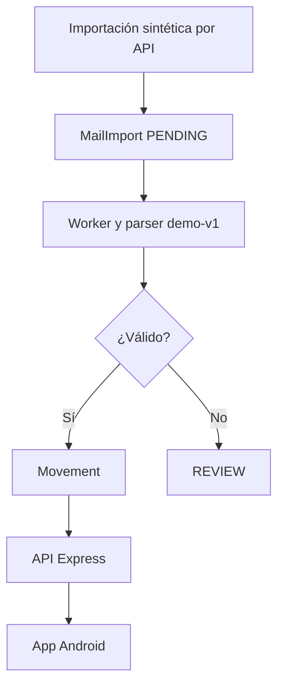

# Arquitectura inicial

Monorepo pnpm workspaces. Una API y un worker comparten dominio y acceso PostgreSQL. TypeScript se ejecuta mediante tsx en desarrollo; la app usa Metro. Los paquetes internos exportan fuente para evitar compilación previa.

## Decisiones

- Dinero en centavos enteros, moneda obligatoria, sin conversiones implícitas.
- Transferencias propias no participan en ingresos y gastos. Todavía no se modelan cuentas, deuda, devoluciones ni conciliación.
- externalId único evita reimportar el mismo mensaje. No deduplica mensajes distintos sobre una misma operación: esa capacidad está pendiente.
- SELECT FOR UPDATE SKIP LOCKED mantiene un mensaje bloqueado mientras se procesa. Crear movimiento y actualizar importación ocurre en una sola transacción; un fallo revierte ambas acciones. importId único añade protección.
- Desde v0.7 hay reservas durables, backoff e intentos limitados; FAILED permite reintento manual. Ver el contrato de recuperación al final.
- API personal: desde v0.8 hay un único propietario y sesiones revocables, sin aislamiento multiusuario. El token inicial solo funciona antes de configurar la cuenta. Health y las rutas acotadas de acceso tienen la política descrita en SECURITY.md.
- Desde v0.6 el historial remoto es paginado y summary calcula todos los registros por mes/moneda, con comparación mensual. Las rutas legacy conservan sus límites solo para compatibilidad.
- No se guarda token en AsyncStorage ni EXPO_PUBLIC_*. Desde v0.8 web lo mantiene en memoria y nativo usa SecureStore con validación al restaurar.

## Próxima arquitectura de correo

OAuth -> conector Gmail/Graph -> jobs persistidos -> parser versionado por banco -> validación/revisión -> movimientos -> API -> app. Definir identidad de usuario, permisos mínimos, cifrado de tokens, retención, consentimiento y revocación antes de incorporar información real. No almacenar contraseñas bancarias.

## Cliente v0.2

Tema centralizado en src/theme.ts. Componentes de controles y formulario separados de la pantalla. AsyncStorage conserva solo datos ficticios de demo y presupuestos locales; la API nunca se copia al almacenamiento local. React Query conserva respuestas API solo en memoria y se limpia al desconectar. Falta un esquema de usuario para presupuestos sincronizados. El CSV neutraliza prefijos de fórmulas y escapa comillas/saltos de línea.

## Cliente y revisión v0.3

DESIGN.md gobierna los tokens Dark Slate/esmeralda/cian y la navegación inferior de cuatro secciones. WeeklyFlow grafica datos reales del conjunto seleccionado sin métricas inventadas. ReviewInbox comparte MovementForm para validar la confirmación manual; los pendientes no se contabilizan. Se conserva la clave de almacenamiento v2 y se inicializa reviews cuando falte en datos anteriores.

La API confirma bajo SELECT FOR UPDATE en una transacción: crea movimiento y cambia REVIEW -> PARSED. Un segundo intento recibe 409; descartar cambia REVIEW -> DISMISSED sin crear movimientos. Ambas acciones vacían el cuerpo. El endpoint de detalle requiere el mismo Bearer y se consulta bajo acción explícita.

El launcher Expo usa rutas absolutas y cwd apps/mobile, comprueba dependencias y limpia caché. La prueba dev cubre el bundle lazy/hermes y navegación web; CI incluye Windows y Linux. Un HTTP 500 sin cuerpo no basta para atribuir causa.

## v0.5: pnpm, acceso y preferencias

Gestor fijado a pnpm 10.34.7; workspaces con enlaces workspace:* y hoisted para Expo. Solo se permiten builds de instalación declarados. Inicio/registro viven en AuthPreview como rutas visuales, con envío deshabilitado y sin persistencia de campos. Volver a una pantalla de acceso desmonta Home y limpia la caché React Query/sesión en memoria.

AccountSettings conserva solo currency/hideAmounts en flowsaldo.preferences.v1. No cambia la identidad ni autentica. La clave demo v2 permanece compatible. La privacidad es visual, no cifra ni elimina importes en exportaciones/formularios.

CSV ejecuta validadores de nombre/esquema antes de descargar. ExcelJS solo se usa en herramientas Node de desarrollo para inspeccionar .xlsx, nunca en el bundle móvil. LANGUAGE.md y los perfiles language-editor/export-guardian agregan controles al plan IA.

## v0.6: recurrencias y pruebas enfocadas

RecurringTemplate conserva calendario mensual y versión; RecurringOccurrence registra confirmaciones con clave única por fecha y FK nullable al movimiento. La transacción bloquea plantilla/categoría, valida versión/vencimiento y crea movimiento, recibo y siguiente fecha de forma atómica. Sin scheduler. Demo aplica la misma regla con recibos persistidos en AsyncStorage; no sincroniza instancias. Summary agrega meses actual/anterior en snapshot común. Importaciones exponen únicamente el ID del movimiento generado para consulta autorizada.

La exportación nativa usa implementación .native.ts con File/Directory/Paths y expo-sharing; web conserva Blob. La caché retiene archivos para recepción externa. Las pruebas se distribuyen por riesgo: reglas financieras en 9 unitarias CORE, integridad transaccional en API y 3 recorridos críticos de Playwright; Metro verifica solo arranque.

## v0.7: reserva durable y recuperación

La reclamación es una transacción corta: selecciona PENDING elegible o PROCESSING vencido con SKIP LOCKED, incrementa intentos y persiste token/expiración. La finalización verifica el token bajo bloqueo y crea movimiento/cambia estado en una transacción. Un dueño antiguo no puede finalizar una reserva recuperada. Ante fallo se agenda otro intento o FAILED; al recuperar un quinto intento interrumpido se detiene el ciclo. La idempotencia mantiene externalId e importId únicos.

Los códigos de resultado son públicos y acotados; el token de propietario solo vive en PostgreSQL/worker. Stats usa snapshot consistente y la UI lo describe como estado de importaciones, sin simular conectividad. El reencolado manual es explícito, limitado a FAILED sin movimiento y con protección concurrente. No se añade un scheduler externo ni servicios adicionales.

## v0.8: propietario único y sesiones

AppOwner id=1 conserva la instalación personal sin reescribir filas financieras. La creación inicial exige el secreto de configuración y el constraint impide un segundo propietario aun con solicitudes concurrentes. Crear AppOwner desactiva el acceso a datos con DEV_API_TOKEN. No se añade un ownerId ficticio a cada tabla ni se anuncia soporte multiusuario.

AuthThrottle persiste ventanas por IP/acción. Contraseñas usan scrypt y la emisión de sesión se serializa con cambios de contraseña; AccessSession guarda hashes de tokens opacos y permite expirar/revocar. Cambiar la contraseña revoca todas las sesiones. Los endpoints solo retornan DTOs públicos. El middleware vuelve a validar sesión en cada solicitud y marca respuestas no-store.

AuthScreen reemplaza la vista previa. Web mantiene credenciales solo en memoria; la implementación nativa de accessVault usa SecureStore con URL ligada y /auth/me antes de restaurar. Un 401 de datos en sesión personal limpia credenciales/caché y vuelve al acceso. La demo sigue abriendo sin API. No se cifran los datos demo/presupuestos ni se implementa recuperación por correo.

Production rechaza HTTP; un proxy TLS local requiere confianza loopback explícita. El despliegue TLS real y la validación física de SecureStore siguen pendientes. QA agrega solo un cuarto recorrido crítico de acceso/cambio/salida; las combinaciones de seguridad quedan en integración.

## v0.9: recuperación y limpieza manual

RecoveryCode guarda hashes de códigos offline; AppOwner serializa generación/consumo/cambio de contraseña. Recuperar elimina el lote completo y revoca sesiones. CleanupPreview conserva un conjunto limitado de IDs con cutoff y expiración; DataCleanup guarda auditoría de cantidades. Aplicar exige reautenticación/confirmación y revalida elegibilidad dentro de la transacción, sin borrar movimientos ni ampliar el conjunto previsualizado. No incorpora correo de recuperación, borrado total ni tareas automáticas de retención.
