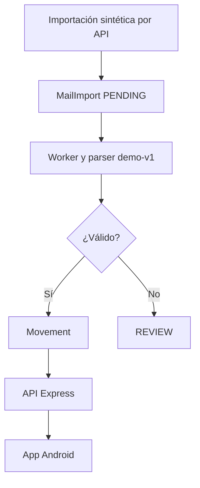

# Arquitectura inicial

Monorepo npm workspaces. Una API y un worker comparten dominio y acceso PostgreSQL. TypeScript se ejecuta mediante tsx en desarrollo; la app usa Metro. Los paquetes internos exportan fuente para evitar compilación previa.

## Decisiones

- Dinero en centavos enteros, moneda obligatoria, sin conversiones implícitas.
- Transferencias propias no participan en ingresos y gastos. Todavía no se modelan cuentas, deuda, devoluciones ni conciliación.
- externalId único evita reimportar el mismo mensaje. No deduplica mensajes distintos sobre una misma operación: esa capacidad está pendiente.
- SELECT FOR UPDATE SKIP LOCKED mantiene un mensaje bloqueado mientras se procesa. Crear movimiento y actualizar importación ocurre en una sola transacción; un fallo revierte ambas acciones. importId único añade protección.
- Errores transitorios reintentan cada dos segundos. No hay contador/backoff ni dead-letter: implementar antes del piloto real.
- API de desarrollo para una sola persona con token compartido. No hay usuarios ni aislamiento multiusuario. Health es público; los demás endpoints exigen Bearer.
- La app limita la lista remota a 200 registros del mes y moneda seleccionados e identifica ese alcance. El endpoint summary usa todos los registros; no tiene filtros mensuales todavía; la app filtra por mes mediante GET /movements y calcula sus propios indicadores sobre ese subconjunto.
- No se almacena token en disco ni en EXPO_PUBLIC_*. La sesión del móvil vive en memoria.

## Próxima arquitectura de correo

OAuth -> conector Gmail/Graph -> jobs persistidos -> parser versionado por banco -> validación/revisión -> movimientos -> API -> app. Definir identidad de usuario, permisos mínimos, cifrado de tokens, retención, consentimiento y revocación antes de incorporar información real. No almacenar contraseñas bancarias.

## Cliente v0.2

Tema centralizado en src/theme.ts. Componentes de controles y formulario separados de la pantalla. AsyncStorage conserva solo datos ficticios de demo y presupuestos locales; la API nunca se copia al almacenamiento local. React Query conserva respuestas API solo en memoria y se limpia al desconectar. Falta un esquema de usuario para presupuestos sincronizados. El CSV neutraliza prefijos de fórmulas y escapa comillas/saltos de línea.

## Cliente y revisión v0.3

DESIGN.md gobierna los tokens Dark Slate/esmeralda/cian y la navegación inferior de cuatro secciones. WeeklyFlow grafica datos reales del conjunto seleccionado sin métricas inventadas. ReviewInbox comparte MovementForm para validar la confirmación manual; los pendientes no se contabilizan. Se conserva la clave de almacenamiento v2 y se inicializa reviews cuando falte en datos anteriores.

La API confirma bajo SELECT FOR UPDATE en una transacción: crea movimiento y cambia REVIEW -> PARSED. Un segundo intento recibe 409; descartar cambia REVIEW -> DISMISSED sin crear movimientos. Ambas acciones vacían el cuerpo. El endpoint de detalle requiere el mismo Bearer y se consulta bajo acción explícita.

El launcher Expo usa rutas absolutas y cwd apps/mobile, comprueba dependencias y limpia caché. La prueba dev cubre el bundle lazy/hermes y navegación web; CI incluye Windows y Linux. Un HTTP 500 sin cuerpo no basta para atribuir causa.
